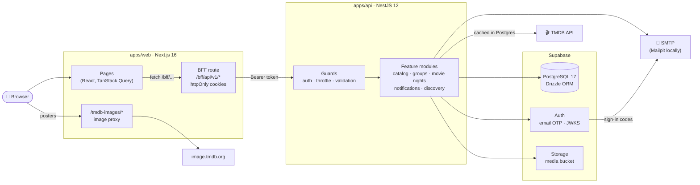
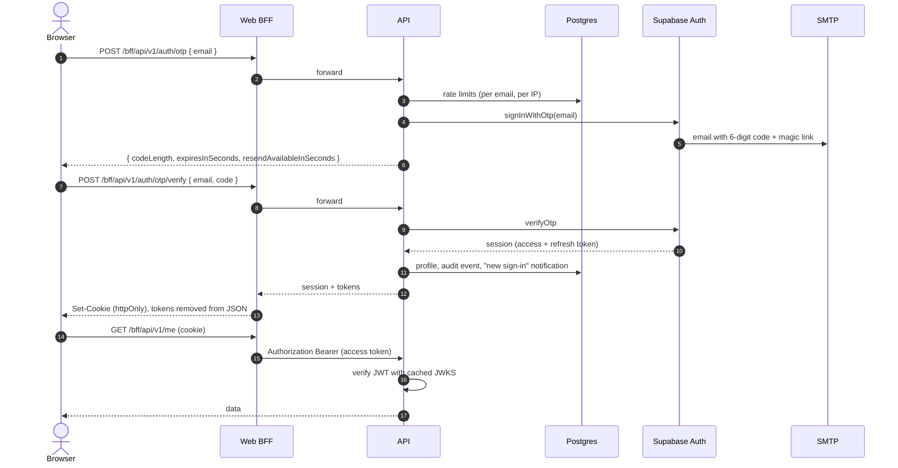
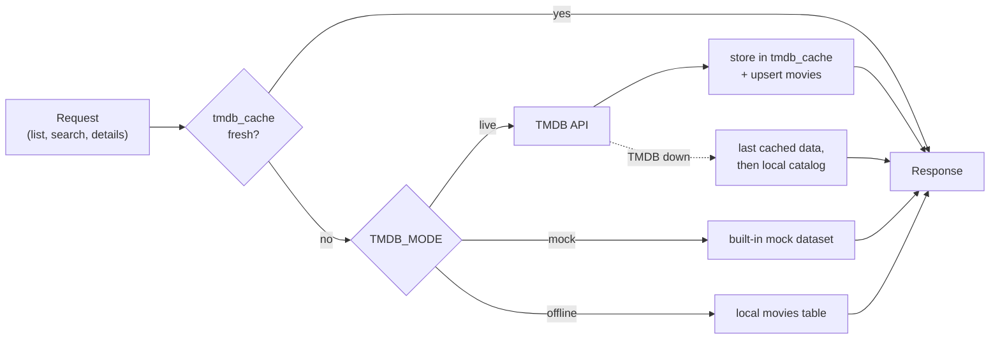
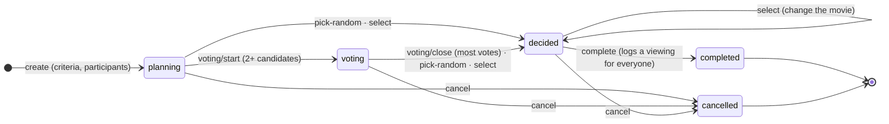
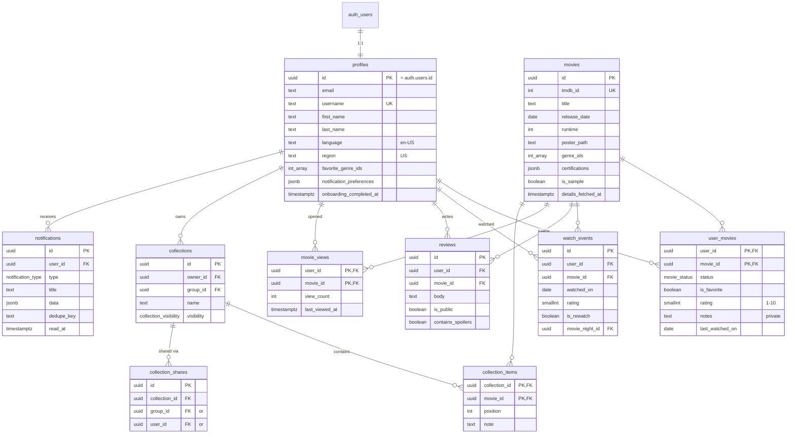
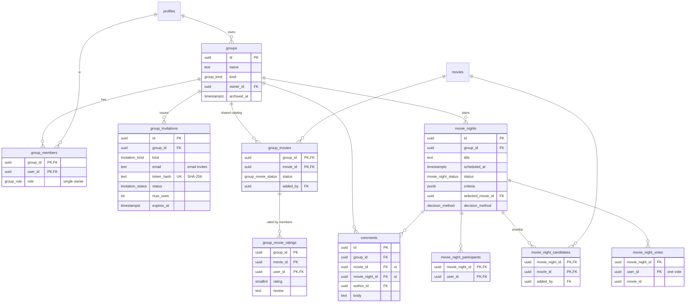
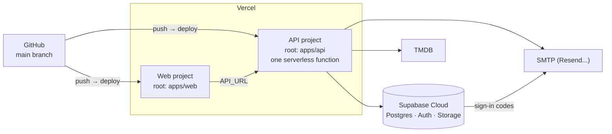

<div align="center">

# 🎬 My Movie Catalog

**Discover movies, keep your watchlist and history, and decide together what to watch on movie
night.**


[Quick start](#-quick-start) · [Architecture](#-architecture) · [How it works](#-how-it-works) ·
[Database](#-database) · [Deployment](#-deployment) · [API](#-api-overview)

</div>

---

## ✨ Features

|                         |                                                                                                                                         |
| ----------------------- | --------------------------------------------------------------------------------------------------------------------------------------- |
| 🔐 **Passwordless**     | 6-digit email codes and magic links, no passwords. Session list, sign out of one / other / all devices, rate and attempt limits.        |
| 🎞️ **Discover**         | TMDB lists, search, advanced filters, movie and person pages with cast, trailers, age ratings, similar titles and where to watch.       |
| 📚 **Personal catalog** | Statuses (want to watch, watching, watched, not interested), favorites, ratings, private notes, viewing history, rewatches, stats.      |
| 🗂️ **Collections**      | Custom lists: private, shared with a group or a person, or public by link.                                                              |
| 👨‍👩‍👧 **Groups**           | Family and friends groups with roles, email and link invitations, a shared catalog with each member's status, group ratings, @mentions. |
| 🍿 **Movie nights**     | Criteria, suggestions, a shortlist, anonymous voting, a random pick, then the viewing is logged for every participant.                  |
| 🔔 **Notifications**    | In-app and email notifications with per-type preferences, release reminders, a calendar.                                                |
| ✨ **Recommendations**  | Home page, "because you liked", favorite genres, popular in your groups, hidden gems.                                                   |
| 🧪 **Developer tools**  | A mock TMDB dataset (no key needed), Swagger UI with one-click sign-in, a local inbox and a ready-made demo family.                     |

The web app covers every API feature, has light and dark themes and works on phones.

---

## 🚀 Quick start

### Prerequisites

- **Node.js 22** (see `.nvmrc`) and npm.
- **Docker** running, for example [OrbStack](https://orbstack.dev/) or Docker Desktop. Supabase
  Local runs in containers.
- _Optional:_ a free [TMDB](https://developer.themoviedb.org/) **API Read Access Token**. Without it
  the API answers from a built-in mock of TMDB.

### Run it

```bash
npm install     # API, web app and the Supabase CLI
npm run setup   # starts Supabase Local (the first run downloads images) and writes apps/api/.env
npm run dev     # API + web app in watch mode
```

| What                    | URL                            |
| ----------------------- | ------------------------------ |
| 🌐 Web app              | http://localhost:3000          |
| ⚙️ API                  | http://127.0.0.1:3001/api/v1   |
| 📖 API docs (Swagger)   | http://127.0.0.1:3001/api/docs |
| 📬 Email inbox          | http://127.0.0.1:54324         |
| 🗄️ Database UI (Studio) | http://127.0.0.1:54323         |

> [!TIP]
> The sign-in page shows **development shortcuts**: sign in as Anna, Ben or Chloe without a code,
> create a demo family (group, shared catalog, a movie night in the voting phase) in one click, or
> fill in the code from the local inbox.

**Live movie data:** add `TMDB_API_READ_ACCESS_TOKEN=...` to `apps/api/.env` (or `.env.local`) and
restart the API. `npm run env:sync` never overwrites values you added yourself.

**Stop and restart:** `npm run supabase:stop` keeps the data, `npm run supabase:start` brings it
back. `npm run db:reset` **wipes** the local database and reloads migrations and sample movies.

### Try the API in Swagger UI

1. `POST /api/v1/dev/sign-in` with `{ "email": "anna@example.com" }`. Swagger applies the token
   automatically.
2. `POST /api/v1/dev/demo` creates the Anna / Ben / Chloe family and returns a token for each
   member (`{ "namespace": "smiths" }` creates another family).
3. Explore: `GET /api/v1/home`, `GET /api/v1/movies/search?query=toy`, `PUT /api/v1/me/movies/862`,
   `PUT /api/v1/movie-nights/{id}/vote`...

To try the real email flow, call `POST auth/otp`, read the code with `GET dev/mailbox?email=...`,
then `POST auth/otp/verify`. The raw OpenAPI document is at `/api/docs/openapi.json`.

---

## 🏗️ Architecture

Two apps in one npm workspace. The **web app** never talks to Supabase and never sees tokens: the
browser calls the web app's own backend route (BFF), which forwards requests to the **API**. The
API is the only service that talks to the database, Supabase Auth, TMDB and SMTP.



| Layer   | Choice                                                                                                   |
| ------- | -------------------------------------------------------------------------------------------------------- |
| API     | [NestJS 12](https://nestjs.com/) (ESM), TypeScript 6 strict, class-validator, OpenAPI from the code      |
| Web     | [Next.js 16.4](https://nextjs.org/) App Router with Cache Components, React 19, Tailwind CSS 4, Radix UI |
| Data    | PostgreSQL 17 (Supabase), [Drizzle ORM](https://orm.drizzle.team/) schema and SQL migrations             |
| Auth    | Supabase Auth (email OTP and magic links). The API verifies access tokens locally against the JWKS.      |
| Files   | Supabase Storage, `media` bucket (avatars, group pictures, collection covers)                            |
| Movies  | [TMDB API](https://developer.themoviedb.org/), cached in Postgres, plus a mock dataset for development   |
| Email   | Any SMTP (Resend, Gmail...). Locally [Mailpit](https://mailpit.axllent.org/).                            |
| Quality | ESLint 10 (type-aware), Prettier 3, Vitest 5, Supertest end-to-end, Playwright smoke tests               |

---

## ⚙️ How it works

### Signing in

Supabase Auth issues the codes and sessions, but only the API calls it. That lets the API add its
own protection (rate limits, attempt counting, identical answers for known and unknown addresses).



- **Cookies:** `mmc_at` (access token) and `mmc_rt` (refresh token, 30 days) are httpOnly. A
  readable `mmc_signed_in=1` only tells the page that a session exists.
- **Refresh:** the BFF refreshes the access token shortly before it expires, retries once on
  `TOKEN_EXPIRED`, and clears cookies when the session was revoked.
- **CSRF:** requests that change data must be same-origin (`Sec-Fetch-Site` / `Origin`), on top of
  `SameSite=Lax`.
- **Private pages:** `apps/web/src/proxy.ts` redirects signed-out visitors to
  `/sign-in?next=...`. The API still enforces every permission.

### Movie data



| Mode      | Chosen by `auto` when             | What you get                                                               |
| --------- | --------------------------------- | -------------------------------------------------------------------------- |
| `live`    | a TMDB key is set                 | Real data, cached in Postgres (lists 1 h, search 15 min, details 12 h)     |
| `mock`    | no key and `NODE_ENV=development` | TMDB-shaped responses from `apps/api/src/tmdb/mock`, generated SVG posters |
| `offline` | no key in tests and production    | Only the local catalog (46 bundled sample movies and movies saved before)  |

A movie is stored once in the shared `movies` table the first time someone saves or opens it, so
every user, group and movie night points to the same row. The mock dataset has the 46 sample movies
with real TMDB ids plus 10 fictional ones whose release dates move with today, so "upcoming" and
release reminders always have content.

### Movie nights



Suggestions match the criteria (genres, runtime, age rating) and show which participants have
already watched each movie. Each participant has one vote, and votes stay anonymous until the movie
is decided.

### Notifications and background work

- `NotificationsService` writes in-app notifications and sends emails based on each user's
  preferences. A `dedupe_key` prevents duplicates, for example for release reminders.
- Scheduled jobs (`apps/api/src/jobs`) run on a long-running server:

  | Job                    | When       | What it does                                                   |
  | ---------------------- | ---------- | -------------------------------------------------------------- |
  | `release-reminders`    | 08:00 UTC  | Notifies about watchlist movies released soon                  |
  | `cleanup`              | every hour | Purges expired rate-limit buckets, OTP state and TMDB cache    |
  | `unconfirmed-accounts` | 03:30 UTC  | Removes accounts that never confirmed their email after 7 days |

  On Vercel (serverless) the scheduler is not started (`JOBS_ENABLED=false`). The app works
  without these jobs.

---

## 🗄️ Database

PostgreSQL 17 in Supabase. The [Drizzle schema](apps/api/src/database/schema) is the source of
truth, and migrations are in [supabase/migrations](supabase/migrations). Every table has **row
level security enabled with no policies** and the public Supabase roles have no privileges, so the
Supabase Data API cannot read anything. All access goes through the NestJS API.

### Users, movies and the personal catalog



### Groups and movie nights



### Enums and service tables

| Enum                    | Values                                                                                    |
| ----------------------- | ----------------------------------------------------------------------------------------- |
| `movie_status`          | `want_to_watch`, `watching`, `watched`, `not_interested`                                  |
| `group_role`            | `owner`, `admin`, `member`                                                                |
| `group_kind`            | `family`, `friends`, `couple`, `other`                                                    |
| `invitation_kind`       | `email`, `link`                                                                           |
| `invitation_status`     | `pending`, `accepted`, `declined`, `revoked`                                              |
| `collection_visibility` | `private`, `shared`, `public`                                                             |
| `group_movie_status`    | `want_to_watch`, `watched`                                                                |
| `movie_night_status`    | `planning`, `voting`, `decided`, `completed`, `cancelled`                                 |
| `decision_method`       | `vote`, `random`, `manual`                                                                |
| `notification_type`     | group, movie night, mention, release reminder, security and role change events (11 types) |

| Table                | Purpose                                                                |
| -------------------- | ---------------------------------------------------------------------- |
| `genres`             | TMDB genre names (synced from TMDB)                                    |
| `tmdb_cache`         | TMDB responses with an expiry time                                     |
| `rate_limit_buckets` | Fixed-window counters for sign-in and demo limits, shared by instances |
| `auth_otp_state`     | Per-email (hashed) resend cooldown and failed attempts                 |
| `audit_events`       | Sign-ins, deletions, role and ownership changes                        |

### Changing the schema

```bash
# 1. edit apps/api/src/database/schema, then generate a migration into supabase/migrations
npm run db:generate --workspace @my-movie-catalog/api -- --name describe_the_change
# 2. apply it locally without losing data
npx supabase migration up
```

SQL that Drizzle cannot express (triggers, extensions, privileges) goes into a custom migration
(`-- --custom --name ...`). Declare every new table with `.enableRLS()`: a unit test fails if one is
missing.

---

## 📁 Project structure

```
.
├── apps/
│   ├── api/                    NestJS backend
│   │   ├── api/index.js        Vercel function entry (re-exports dist/serverless.js)
│   │   ├── src/
│   │   │   ├── main.ts         long-running server     serverless.ts  Vercel handler
│   │   │   ├── auth/           passwordless sign-in, sessions, guard, demo accounts
│   │   │   ├── profiles/       profile, onboarding, avatar, export, account deletion
│   │   │   ├── movies/ tmdb/   discovery, search, details, TMDB client, cache, mock dataset
│   │   │   ├── library/        personal catalog, history, statistics
│   │   │   ├── reviews/ collections/
│   │   │   ├── groups/         groups, members, invitations, shared catalog, comments
│   │   │   ├── movie-nights/   Movie Night Planner
│   │   │   ├── discovery/      home page, recommendations, calendar
│   │   │   ├── notifications/ jobs/ mail/ media/ audit/ rate-limit/ health/
│   │   │   ├── dev-tools/      dev-only Swagger helpers + demo accounts endpoint
│   │   │   └── database/       Drizzle schema (source of truth)
│   │   ├── scripts/            build helpers (Swagger UI assets for Vercel)
│   │   └── test/               end-to-end tests
│   └── web/                    Next.js web app
│       └── src/
│           ├── app/            (app) pages · (auth) sign-in · bff/[...path] API proxy
│           ├── features/       one folder per area (movie, library, groups, movie-nights...)
│           ├── components/     UI kit, layout, movie cards and dialogs, charts, calendar
│           ├── lib/            API client and types, TanStack Query hooks, session helpers
│           └── proxy.ts        redirects signed-out visitors from private pages
├── supabase/                   config.toml · migrations/ · seed.sql · templates/ (emails)
├── docs/deploy-vercel.md       step-by-step deployment guide
└── scripts/sync-env.mjs        writes apps/api/.env from the running local stack
```

---

## 🔧 Configuration

The API reads `apps/api/.env` (generated by `npm run setup`) and `.env.local` for your overrides.
Templates: [apps/api/.env.example](apps/api/.env.example), [apps/web/.env.example](apps/web/.env.example).
Every variable is validated at startup.

| Variable                                                         | Purpose                                                                  |
| ---------------------------------------------------------------- | ------------------------------------------------------------------------ |
| `DATABASE_URL`, `DATABASE_POOL_MAX`                              | Postgres connection (use the Supabase transaction pooler in production)  |
| `SUPABASE_URL`, `SUPABASE_ANON_KEY`, `SUPABASE_SERVICE_ROLE_KEY` | Supabase Auth and Storage                                                |
| `TMDB_MODE`, `TMDB_API_READ_ACCESS_TOKEN`                        | Movie data source (`auto`, `live`, `mock`, `offline`)                    |
| `TMDB_IMAGE_BASE_URL`                                            | Where posters load from. Set to `<web>/tmdb-images` to proxy them        |
| `SMTP_*`, `MAIL_FROM`                                            | Outgoing email (invitations, notifications)                              |
| `WEB_APP_URL`, `CORS_ORIGINS`, `PUBLIC_API_URL`                  | Links in emails and allowed origins                                      |
| `RATE_LIMIT_PER_MINUTE`, `OTP_*`                                 | General and sign-in limits                                               |
| `JOBS_ENABLED`, `SWAGGER_ENABLED`, `TRUST_PROXY`                 | Scheduler, API docs, client IPs behind a proxy                           |
| `DEV_TOOLS_ENABLED`                                              | `/dev/*` helpers. On in development, **cannot** be enabled in production |
| `DEMO_ACCOUNTS_ENABLED`                                          | Shared demo accounts on the sign-in page (off by default)                |
| `API_URL` _(web)_                                                | Where the web BFF forwards requests                                      |

---

## 🧰 Commands

| Command                                    | What it does                                          |
| ------------------------------------------ | ----------------------------------------------------- |
| `npm run dev`                              | API and web app in watch mode (`dev:api` / `dev:web`) |
| `npm run build`                            | Production builds                                     |
| `npm run check`                            | Formatting, lint, types and unit tests in one go      |
| `npm run lint` · `npm run typecheck`       | ESLint (type-aware) · TypeScript                      |
| `npm run format` / `npm run format:check`  | Prettier                                              |
| `npm test`                                 | Unit tests (API and web)                              |
| `npm run test:e2e`                         | End-to-end tests (local stack must be running)        |
| `npm run test:ui -w @my-movie-catalog/web` | Playwright browser smoke tests                        |
| `npm run supabase:status`                  | URLs and keys of the local stack                      |
| `npm run env:sync`                         | Regenerate the Supabase values in `apps/api/.env`     |
| `npm run db:reset`                         | Wipe and re-seed the local database                   |

### Testing

- **Unit tests:** voting and shortlist logic, filters, presenters, configuration, TMDB client and
  mock dataset, Swagger auto-authorization, demo accounts. In the web app: the BFF route (cookies, token
  stripping, refresh, revoked sessions, cross-site rejection), session helpers, the API client.
- **End-to-end tests** run the whole API against Supabase Local and read real emails from Mailpit:
  sign-up and sign-in with codes and magic links, rejected invalid / expired / reused codes, rate
  limits, sign-out everywhere, catalog privacy, invitations and permissions, movie nights with
  voting and random picks, collections, reviews, calendar and reminders.
- **Browser smoke tests** (Playwright): guest browsing, the redirect to sign-in, then the demo
  family flow end to end.

---

## ☁️ Deployment

Free-tier production setup: **Vercel** (two projects from this repository) + **Supabase Cloud** +
any SMTP provider. The full step-by-step guide is in
**[docs/deploy-vercel.md](docs/deploy-vercel.md)** (in Russian).



What is specific to the serverless setup:

- **One function for the whole API.** `apps/api/api/index.js` loads `dist/serverless.js`, which
  boots Nest once per instance. `vercel.json` rewrites every path to it.
- **No scheduler.** `ScheduleModule` is skipped when `VERCEL` is set. Keep `JOBS_ENABLED=false`.
- **Swagger UI assets** are copied into `public/api/docs` at build time
  (`scripts/copy-swagger-assets.mjs`), because the function bundle does not include them.
- **Posters through the web domain.** `image.tmdb.org` is blocked by some ISPs and mobile carriers.
  The web app rewrites `/tmdb-images/*` to TMDB, so set
  `TMDB_IMAGE_BASE_URL=https://<web>/tmdb-images` on the API.
- **Per-IP limits are raised.** Every browser reaches the API through the web server, so users
  share a few source IPs. Per-email sign-in limits stay strict.
- **Demo accounts (optional).** `DEMO_ACCOUNTS_ENABLED=true` shows _Try a demo account_ (Anna,
  Ben, Chloe) on the sign-in page of a test deployment. Only these shared accounts can be entered
  without a code. Their session IPs are hidden, they cannot send email invitations, and demo
  sign-ins are capped globally.

---

## 📡 API overview

All routes live under `/api/v1`. Authenticate with `Authorization: Bearer <accessToken>`;
discovery endpoints also work for guests. Errors always look like
`{ "statusCode": 404, "error": "Not Found", "code": "GROUP_NOT_FOUND", "message": "..." }`, and
lists return `{ items, page, pageSize, total, totalPages }`.

| Area           | Main endpoints                                                                                                                                                           |
| -------------- | ------------------------------------------------------------------------------------------------------------------------------------------------------------------------ |
| Auth           | `POST auth/otp`, `auth/otp/verify`, `auth/magic-link/verify`, `auth/refresh`, `auth/sign-out`, `GET auth/sessions`                                                       |
| Profile        | `GET/PATCH me`, `POST me/onboarding`, `PUT me/avatar`, `GET me/export`, `DELETE me`                                                                                      |
| Discovery      | `GET home`, `movies/lists/{popular,trending,top-rated,upcoming,now-playing}`, `movies/search`, `movies/discover`, `movies/{tmdbId}`, `people/{id}`, `genres`, `config`   |
| My catalog     | `GET me/movies`, `PUT/DELETE me/movies/{tmdbId}`, `GET me/movies/random`, `me/history`, `me/stats`, `me/recommendations`, `me/calendar`                                  |
| Reviews        | `PUT/DELETE me/reviews/{tmdbId}`, `GET movies/{tmdbId}/reviews`                                                                                                          |
| Collections    | `collections`, `collections/{id}/items`, `collections/{id}/shares`, `public/collections/{id}`                                                                            |
| Groups         | `groups`, `groups/{id}/members`, `groups/{id}/invitations`, `groups/{id}/invitation-links`, `invitations/{token}/accept`                                                 |
| Shared catalog | `groups/{id}/movies`, `.../{tmdbId}/rating`, `.../{tmdbId}/comments`, `groups/{id}/calendar`                                                                             |
| Movie nights   | `groups/{id}/movie-nights`, `movie-nights/{id}/suggestions`, `/candidates`, `/voting/start`, `/vote`, `/voting/close`, `/pick-random`, `/select`, `/complete`, `/cancel` |
| Notifications  | `me/notifications`, `me/notification-preferences`                                                                                                                        |
| Health         | `GET health` (database, auth and TMDB checks)                                                                                                                            |
| Dev / demo     | `POST dev/sign-in`, `GET dev/mailbox`, `POST dev/demo` (development only) · `POST demo/sign-in` (`DEMO_ACCOUNTS_ENABLED`)                                                |

Swagger UI documents every endpoint, parameter and validation rule.

---

## 🛡️ Security and privacy

- **No passwords.** Single-use 6-digit codes or magic links that expire after 10 minutes. Responses
  never reveal whether an address is registered.
- **Abuse protection.** 60 s between codes, per-address and per-IP hourly limits, 5 wrong codes per
  issued code. Counters live in Postgres, so they survive restarts and are shared by instances. A
  general per-IP request limit applies to every route.
- **Sessions.** 1-hour access tokens verified locally against the Supabase JWKS, rotating refresh
  tokens, revoked sessions rejected immediately, 30-day lifetime and 14-day inactivity limit.
- **Private by default.** Catalog entries, ratings, notes and private reviews are only returned to
  their owner. Non-members get "not found" for groups. Other users are shown by name, never by
  email.
- **Invitations.** Tokens are stored only as SHA-256 hashes. Email invitations can only be accepted
  with the invited address.
- **Uploads.** Checked by content (PNG, JPEG, WebP; max 2 MB), not by the declared type.
- **Account deletion.** Requires a fresh email code, hands owned groups to another member and
  removes all personal data in one transaction. `GET /me/export` downloads everything as JSON.
- **Audit.** Sign-ins, deletions, role and ownership changes are written to `audit_events`.
- **Secrets.** The TMDB token, the Supabase service key and SMTP credentials live only in the API
  environment. `.env` files are git-ignored. The browser holds tokens only in httpOnly cookies.

---

## 🧭 Design decisions

- **ESLint instead of oxlint:** for type-aware rules (floating promises, unsafe `any`). TypeScript
  is pinned to `~6.0`, the newest version typescript-eslint supports.
- **Supabase CLI 2.x:** the mature line, until 3.x settles.
- **Favorite is a flag, not a status:** a movie can be both "watched" and a favorite. "Not
  interested" hides a movie from lists and recommendations.
- **Group ratings are separate from personal ratings:** members share a rating with a group
  explicitly. Personal statuses of movies in a group's catalog are visible to its members, so the
  family can see who watched what.
- **Email confirmation on:** the first successful code confirms the address. Unconfirmed accounts
  are removed after 7 days.
- **Own request throttle:** `@nestjs/throttler` is CommonJS and cannot load the ESM-only Nest 12
  on Vercel, so the API uses a small in-memory guard (`rate-limit/request-throttle.guard.ts`).

## 🗺️ Not built yet

- Interface translations (the UI is in English; movie data follows the profile language).
- An administration area, content reporting and moderation.
- Changing the email address, passkeys, re-authentication for sensitive actions.
- Real-time updates (live voting), push notifications, a richer activity feed.
- Deployment automation (deployment is manual, see [docs/deploy-vercel.md](docs/deploy-vercel.md)).

## 🙏 Attribution

This product uses the TMDB API but is not endorsed or certified by TMDB. Streaming availability
data is provided by JustWatch through TMDB.
